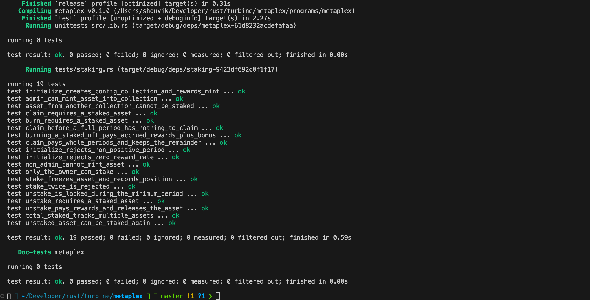

# Metaplex Core NFT Staking Program

A production-grade **Solana staking program** built with [Anchor](https://www.anchor-lang.com/) that allows NFT holders to lock Metaplex Core assets in exchange for on-chain SPL token rewards. Staking state is stored entirely inside the NFT's own Metaplex Core **Attributes plugin** — no separate staking-position PDAs are required.

---

## Table of Contents

- [Overview](#overview)
- [Architecture](#architecture)
- [Program Instructions](#program-instructions)
- [Account State](#account-state)
- [Error Codes](#error-codes)
- [Project Structure](#project-structure)
- [Getting Started](#getting-started)
- [Running Tests](#running-tests)
- [Test Results](#test-results)
- [Key Design Decisions](#key-design-decisions)

---

## Overview

| Feature | Detail |
|---|---|
| **Network** | Solana (localnet / mainnet-beta compatible) |
| **Framework** | Anchor v1.2 |
| **NFT Standard** | Metaplex Core (`mpl-core`) |
| **Reward Token** | Native SPL Token mint (6 decimals) |
| **Program ID** | `AH3hGfZeBmrgydfcw9NdWh5Lv6aHau4D2YhM6fiv7tmD` |
| **Test Runner** | LiteSVM (fast, off-validator) |

The program supports the following lifecycle:

```
Admin deploys pool → Admin mints Core NFTs → Owner stakes NFT
  → Owner claims periodic rewards → Owner unstakes (+ accrued rewards)
                                  → OR burns NFT (accrued rewards + burn bonus)
```

---

## Architecture

```
┌─────────────────────────────────────────────────────────────┐
│                     Metaplex Core NFT                        │
│  ┌──────────────────────────────────────────────────────┐   │
│  │  Attributes Plugin                                   │   │
│  │   staked       = "true" / "false"                    │   │
│  │   staked_at    = <unix timestamp>                    │   │
│  │   last_claimed = <unix timestamp>                    │   │
│  └──────────────────────────────────────────────────────┘   │
│  ┌──────────────────────────────────────────────────────┐   │
│  │  FreezeDelegate Plugin  (authority = update_authority│   │
│  │  BurnDelegate Plugin    PDA, signed by config PDA)   │   │
│  └──────────────────────────────────────────────────────┘   │
└─────────────────────────────────────────────────────────────┘

┌─────────────────────────────────────────────────────────────┐
│                  Collection (Metaplex Core)                  │
│  ┌──────────────────────────────────────────────────────┐   │
│  │  Attributes Plugin                                   │   │
│  │   total_staked = <count>                             │   │
│  └──────────────────────────────────────────────────────┘   │
└─────────────────────────────────────────────────────────────┘

PDAs owned by the program
├── config    [CONFIG_SEED, collection]        → Config account
├── authority [AUTHORITY_SEED, collection]     → Update-authority PDA
└── rewards   [REWARDS_SEED, config]           → SPL Rewards Mint
```

All mutable state that normally lives in a separate "stake receipt" PDA is instead encoded as string key-value pairs inside the NFT's own Attributes plugin. The program's update-authority PDA is the sole entity authorised to write those attributes, ensuring tamper-resistance.

---

## Program Instructions

### `initialize`

Creates the staking pool for a given Metaplex Core collection.

| Parameter | Type | Description |
|---|---|---|
| `name` | `String` | Display name for the collection |
| `uri` | `String` | Metadata URI for the collection |
| `rewards_per_period` | `u64` | Token reward per completed period (raw units) |
| `period_seconds` | `i64` | Length of one reward period in seconds |
| `min_stake_seconds` | `i64` | Minimum time an asset must be staked before unstaking |
| `burn_bonus` | `u64` | Extra tokens awarded when burning a staked NFT |

**Accounts created:** `Config` PDA, SPL `Rewards Mint` PDA, Metaplex Core Collection.

---

### `mint_asset`

Mints a new Metaplex Core NFT into the pool's collection. Only the pool admin can call this.

| Parameter | Type | Description |
|---|---|---|
| `name` | `String` | Asset name |
| `uri` | `String` | Asset metadata URI |

---

### `stake`

Locks an NFT into the staking pool.

- Verifies the caller is the asset owner.
- Verifies the asset belongs to the correct collection.
- Rejects if a `FreezeDelegate` plugin already exists (already staked).
- Adds `FreezeDelegate` (frozen = true) and `BurnDelegate` plugins, authorised to the program's update-authority PDA.
- Writes `staked = "true"`, `staked_at`, and `last_claimed` as Attributes.
- Increments `total_staked` on the collection.

---

### `claim_rewards`

Claims rewards for fully completed periods since the last claim. Partial periods carry over.

- Fails with `NothingToClaim` if fewer than one full period has elapsed.
- Mints `periods × rewards_per_period` tokens to the owner's ATA.
- Advances `last_claimed` by exactly the number of elapsed full periods.

---

### `unstake`

Releases a staked NFT back to the owner, paying all accrued rewards first.

- Fails with `StakeLocked` if `min_stake_seconds` has not elapsed.
- Mints any accrued rewards.
- Removes `FreezeDelegate` and `BurnDelegate` plugins.
- Sets `staked = "false"`.
- Decrements `total_staked` on the collection.

---

### `burn_staked_nft`

Permanently burns a staked NFT, paying accrued rewards **plus** the configured `burn_bonus`.

- Can be called even before the minimum staking period has elapsed.
- Mints `accrued_rewards + burn_bonus` tokens.
- Burns the Core asset via CPI.
- Decrements `total_staked` on the collection.

---

## Account State

### `Config`

Stored at PDA `[b"config", collection]`.

```rust
pub struct Config {
    pub admin: Pubkey,              // Pool administrator
    pub collection: Pubkey,         // Associated Metaplex Core collection
    pub rewards_per_period: u64,    // Reward tokens per completed period
    pub period_seconds: i64,        // Duration of one reward period
    pub min_stake_seconds: i64,     // Lock-up duration before unstaking
    pub burn_bonus: u64,            // Bonus tokens for burning a staked NFT
    pub config_bump: u8,
    pub authority_bump: u8,
    pub rewards_bump: u8,
}
```

### NFT On-Chain Attributes

All staking state is stored inside the asset's Metaplex Core **Attributes plugin**:

| Key | Value | Set by |
|---|---|---|
| `staked` | `"true"` / `"false"` | `stake` / `unstake` |
| `staked_at` | Unix timestamp string | `stake` |
| `last_claimed` | Unix timestamp string | `stake`, `claim_rewards`, `unstake` |

The collection also carries:

| Key | Value |
|---|---|
| `total_staked` | Running count of currently staked NFTs |

---

## Error Codes

| Error | Message |
|---|---|
| `InvalidPeriod` | The reward period and minimum stake time must be valid |
| `InvalidRate` | The reward rate must be greater than zero |
| `InvalidAsset` | Account is not a Metaplex Core asset |
| `InvalidCollection` | Account is not a Metaplex Core collection |
| `NotOwner` | Signer does not own this asset |
| `WrongCollection` | Asset does not belong to this staking collection |
| `AlreadyStaked` | Asset is already staked or carries a freeze delegate |
| `NotStaked` | Asset is not staked |
| `StakeLocked` | Asset is still inside its minimum staking period |
| `NothingToClaim` | No full reward period has passed since the last claim |
| `InvalidAttribute` | A staking attribute is missing or malformed |
| `Overflow` | Arithmetic overflow |

---

## Project Structure

```
metaplex/
├── Anchor.toml                         # Anchor workspace config
├── Cargo.toml                          # Workspace manifest
├── rust-toolchain.toml                 # Pinned Rust toolchain
├── assets/
│   └── tests.png                       # Test run screenshot
└── programs/
    └── metaplex/
        ├── Cargo.toml
        ├── src/
        │   ├── lib.rs                  # Program entrypoint & instruction routing
        │   ├── state.rs                # Config account + PDA seeds + constants
        │   ├── errors.rs               # StakingError enum
        │   ├── plugins.rs              # mpl-core wrappers & reward math helpers
        │   └── instructions/
        │       ├── mod.rs
        │       ├── initialize.rs       # Initialize instruction
        │       ├── mint_asset.rs       # MintAsset instruction
        │       ├── stake.rs            # Stake instruction
        │       └── position.rs         # ClaimRewards / Unstake / BurnStakedNft
        └── tests/
            ├── fixtures/
            │   └── mpl_core.so         # Mainnet-beta mpl-core program dump
            └── staking.rs              # Full LiteSVM integration test suite
```

---

## Getting Started

### Prerequisites

| Tool | Version |
|---|---|
| Rust | `1.89.0` (pinned via `rust-toolchain.toml`) |
| Solana CLI | `≥ 2.x` |
| Anchor CLI | `≥ 1.2` |
| Node.js | `≥ 18` (for Anchor scripts) |

### Build

```bash
# Build the Solana BPF / SBF binary
cargo build-sbf
```

### Run Tests

```bash
# Build .so and run the full LiteSVM test suite in one command
anchor test
```

> **Refreshing the mpl-core fixture**
> The file `programs/metaplex/tests/fixtures/mpl_core.so` is a dump of the public
> mainnet-beta Metaplex Core program. To update it:
> ```bash
> solana program dump -u mainnet-beta \
>   CoREENxT6tW1HoK8ypY1SxRMZTcVPm7R94rH4PZNhX7d \
>   programs/metaplex/tests/fixtures/mpl_core.so
> ```

---

## Running Tests

Tests live in `programs/metaplex/tests/staking.rs` and use **LiteSVM** — a fast, in-process Solana runtime — so no local validator is required.

The suite covers **19 scenarios** across all six instructions:

### Initialize
| Test | Description |
|---|---|
| `initialize_creates_config_collection_and_rewards_mint` | All accounts created with correct parameters and zero counter |
| `initialize_rejects_zero_reward_rate` | Rejects `rewards_per_period = 0` → `InvalidRate` |
| `initialize_rejects_non_positive_period` | Rejects `period_seconds ≤ 0` → `InvalidPeriod` |

### Mint Asset
| Test | Description |
|---|---|
| `admin_can_mint_asset_into_collection` | Admin successfully mints an NFT into the pool collection |
| `non_admin_cannot_mint_asset` | Non-admin signer is rejected by Anchor `has_one` constraint |

### Stake
| Test | Description |
|---|---|
| `stake_freezes_asset_and_records_position` | Asset frozen, plugins attached, attributes written, counter incremented |
| `stake_twice_is_rejected` | Already-staked asset returns `AlreadyStaked` |
| `only_the_owner_can_stake` | Non-owner returns `NotOwner` |
| `asset_from_another_collection_cannot_be_staked` | Cross-pool asset returns `WrongCollection` |

### Claim Rewards
| Test | Description |
|---|---|
| `claim_before_a_full_period_has_nothing_to_claim` | Partial period returns `NothingToClaim` |
| `claim_pays_whole_periods_and_keeps_the_remainder` | 2.5 periods → pays 2; remainder rolls over to the next claim |
| `claim_requires_a_staked_asset` | Claiming on an unstaked NFT returns `NotStaked` |

### Unstake
| Test | Description |
|---|---|
| `unstake_is_locked_during_the_minimum_period` | Early unstake returns `StakeLocked` |
| `unstake_pays_rewards_and_releases_the_asset` | Accrued rewards minted, plugins revoked, counter decremented |
| `unstaked_asset_can_be_staked_again` | Re-stake after unstake updates attributes correctly |
| `unstake_requires_a_staked_asset` | Unstaking an unstaked NFT returns `NotStaked` |

### Burn Staked NFT
| Test | Description |
|---|---|
| `burning_a_staked_nft_pays_accrued_rewards_plus_bonus` | Burns NFT, pays `accrued + burn_bonus`, decrements counter |
| `burn_requires_a_staked_asset` | Burning an unstaked NFT returns `NotStaked` |
| `total_staked_tracks_multiple_assets` | Counter increments and decrements accurately across multiple assets |

---

## Test Results

All **19 tests pass** in under 1 second with zero failures.



---

## Key Design Decisions

### Stateless Stake Receipts via Attributes Plugin
Rather than allocating a separate "stake receipt" PDA per NFT, all staking state (`staked`, `staked_at`, `last_claimed`) is encoded directly into the NFT's own Metaplex Core Attributes plugin. This eliminates extra account costs for the staker and keeps the NFT self-describing.

### Period-Aligned Reward Accounting
Rewards are only paid for **fully completed periods**. `last_claimed` is always advanced by an exact multiple of `period_seconds`, so any fractional period is naturally carried forward — no rounding loss, no dust accumulation.

### Dual-Delegate Locking
On stake, both a `FreezeDelegate` (prevents transfers) and a `BurnDelegate` (allows the program to burn via CPI) are added to the NFT. On unstake, both are revoked. Burn intentionally bypasses the minimum staking period, enabling token projects to incentivise permanent commitment.

### LiteSVM for Testing
The test suite runs entirely inside LiteSVM — an in-process Solana runtime. No local validator is needed, tests are fully deterministic, and the complete suite finishes in under a second.

### Overflow Safety
The workspace `Cargo.toml` enables `overflow-checks = true` in release builds. All arithmetic further uses `.checked_*` methods and returns `StakingError::Overflow` on failure.
